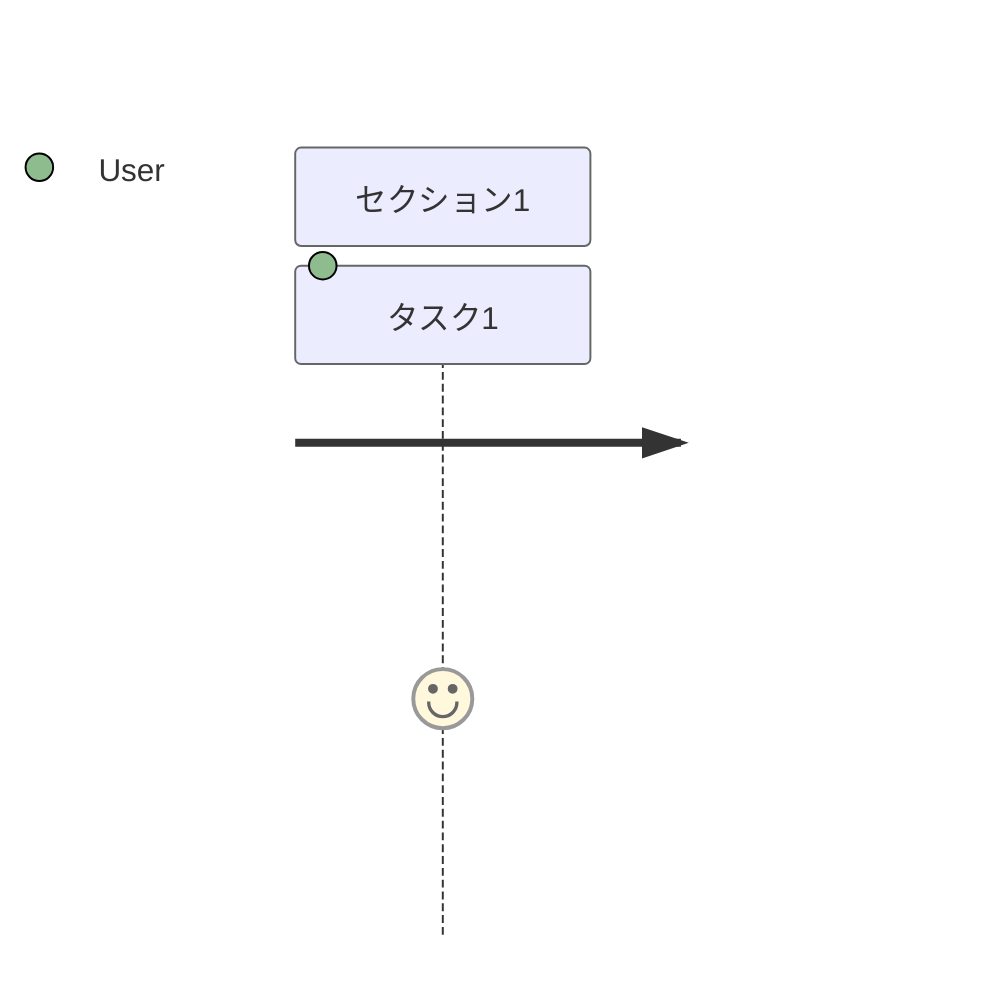

# Markdown Format Extensions — Studio拡張仕様（v0.2.0）

MD Slide Studio 独自のスライドMD拡張仕様。
移植元スキルの `markdown-format.md`（v0.7 系）は**変更せず**、拡張分をここに分離する。
基本仕様（frontmatter・区切り・既存14type・chart/diagramブロック）は元仕様を参照。

> SSOT リファクタで `src/schema/`（zod）からの自動生成に統合予定。
> それまでは本ファイルが拡張仕様の正とする。

---

## 1. 共通ヘッダ拡張（badge / lead / point / note）

全スライドtypeの本文で、**行頭（インデントなし）**に書けるキー。`badge` / `lead` / `point` は見える要素、`note` は既定で見えないスピーカーノート。

```markdown
<!-- slide: points -->
badge: WHY
## AIは、足りない情報を==勝手に補う==
lead: 見出しを補足するグレーの1行
- **リード**：説明
point: スライド下部の💡強調帯（==hl== 強調可）
note: スピーカーノート（既定は非表示。1行が1段落）
note: 何行でも書ける。==強調==や**太字**も使える
```

| キー | 描画 | 備考 |
|---|---|---|
| `badge:` | 見出し左のピル（`.slide-badge`、accent地） | 工程番号（Step 1）や一言ラベル（WHY）に |
| `lead:` | 見出し直下のグレー1行（`.slide-lead`） | title では `subtitle:` と併存可（subtitle→lead の順に描画） |
| `point:` | スライド下部の帯（`.slide-point`、💡自動付与） | 既存の `>` ノート（控えめな補足）とは別物として併存 |
| `note:` | 非表示の `<aside class="slide-notes" hidden>`（1行＝1`<p>`） | 発表者の原稿・配布時の補足。**繰り返し可**（出現順）。空の `note:` は無視。全18type有効 |

規則:

- 対象はコードフェンス外・行頭のキーのみ。feature-showcase 等の **YAML内（インデントあり）の同名キーは対象外**
- badge / lead は見出し（`##` / `#`）を持つtypeで有効。feature-showcase / comparison-chart（独自2カラム構造）では badge / lead は描画されない。**point は全typeで有効**
- badge / lead / point の重複は後勝ち（警告なし）。**`note:` だけは上書きせず出現順に追記**
- 実装: `src/parser/slideHeader.ts`（純関数）→ `SlideBase.badge / lead / point / speakerNotes`

### `note:`（スピーカーノート）の詳細

- AST のフィールド名は `speakerNotes`（`InlineText[]`）。`notes` にしないのは `SvgFigureSlide.notes`（図の右側に見える補足）と衝突するため
- 紛らわしい既存の「note」との違い:

| 記法 | 意味 | 見えるか |
|---|---|---|
| `note:`（単数・行頭キー） | スピーカーノート | 既定で非表示 |
| `> 引用`（本文末尾） | スライド上の補足（`<p class="note">`） | 見える |
| `notes:`（複数形・svg-figure の箇条書き） | 図の右側の補足 | 見える |

- 書き出し: HTML は常に含める（非表示）／PDF は `body[data-notes="on"]` のときだけスライド下にノートを付ける／PNG・ZIP は常にスライドのみ
- 読み方（v0.6.0）: 1枚表示（hero・`V` で切り替え）の右上にある 🗒️ ボタン、または `N` キーで、現在のスライドのノートを**ポップアップ**（背景を暗くしない浮かぶパネル）で表示する。ポップアップ内の「◀ 前へ」「次へ ▶」で、開いたままページ移動できる（`←` `→` も有効）。`Esc`・✕・🗒️ 再押下・`N` で閉じる
  - 🗒️ は**デッキに `note:` が1つでもあるときだけ**出る。現在のスライドにノートが無いときは薄く表示され、開くと「（ノートなし）」と出る
  - 一覧（list）表示では 🗒️ もポップアップも出ない。アプリのプレビュー・`/present`・書き出したHTMLの全てで同じ操作
  - 実装: アプリは `NotesPopup.tsx`、書き出しHTMLは `core/standalone/notesPopup.ts`（DOM の id・クラスは共通、CSS は `nav-controls.css`）
- 書き方の指針: スライドに書ききれない根拠・数字の時点・話す順番を書き、スライド本文の繰り返しは避ける

---

## 2. ディレクティブ拡張: `tone: dark`

```markdown
<!-- slide: steps, tone: dark -->
```

- そのスライドだけ地色系のCSS変数を反転する（`section.slide` に `slide--dark` を付与）
- accent はパレット設定のダーク側の値に切り替わる（ocean → #58a6ff 等）
- 優先順位: **グローバルテーマ < スライドtone**（変数の継承近接性で成立、`!important` 不使用）
- 未知の tone 値は無視して既定表示（`layout:` と同じ前方互換方針・警告なし）
- 用途の目安: 強調したい1〜2枚のみ。多用すると反転の意味が薄れる

---

## 3. 新type: `steps`（カード型ステップフロー）

手順・プロセス・ワークフローを、アイコン・説明文つきカードの横フローで表現する。
図形ノードの流れは従来どおり `diagram-flow`、**内容カードの流れは `steps`** を使う。

### 3-1. 記法

````markdown
<!-- slide: steps -->
badge: Step 1
## デザインガイド生成
lead: ブランド情報をWeb検索 → カラー・フォント・レイアウトルールを自動整理
```steps
style: cards            # cards（上ボーダーカード・既定）/ circled（連番丸バッジ）
items:
  - icon: "🔍"          # 絵文字1文字を想定（任意）
    title: Claude が Web検索
    desc: ブランドカラー／フォント情報／ロゴ・トーン
  - icon: "✨"
    title: Claude が自動整理
  - icon: "🎨"
    title: design-guide.md 完成
    tone: outline       # 任意: dark（反転面）/ outline（枠線強調）
ratio:                  # 任意: セグメント比率帯＋凡例
  - { label: AI 自動, value: 60 }
  - { label: 手動, value: 40 }
```
point: このステップを飛ばすと、毎回バラバラなデザインになる
````

### 3-2. 規則・制約

| 項目 | 規則 |
|---|---|
| items 個数 | 2〜5個。6個以上は先頭5個を描画し警告。1個は警告（描画は継続） |
| style | `cards` / `circled`。未知値は cards にフォールバックし警告 |
| item.tone | `dark` / `outline`。未知値は無視し警告 |
| ratio | 任意。値合計で正規化して描画（合計≠100 は警告のみ）。0以下・非数値の項目はスキップ |
| 矢印 | カード間にCSSで自動挿入（MDには書かない） |
| 系統色 | カード上ボーダー／番号丸／ratio帯は `--chart-1〜5` を順繰りに割当（決定論・パレット追従） |
| 共存禁止 | グラフ・図解・画像との同一スライド共存禁止（既存規定を steps にも適用） |

### 3-3. 描画方式（設計判断）

HTML/CSS（flexbox）で組み、SVGは使わない。SVGの `<text>` は自動折返し不可のため、
アイコン＋複数行テキスト＋説明文のリッチなカードには不向き（feature-showcase で実証済み）。
これにより既存の `fit`（自動縮小）もそのまま効く。

### 3-4. 予約（v0.2.x 以降の拡張候補）

- items 要素のネスト配列（カードの縦積みグループ。参考画像「Step 2」の左2枚構成）
- `desc` の配列許容（カード内サブリスト）

---

## 4. AST 追加分（types.ts）

```ts
type SlideType = ... | 'steps';
type SlideTone = 'dark';
type StepStyle = 'cards' | 'circled';

interface StepItem { icon?: string; title: InlineText; desc?: InlineText; tone?: 'dark' | 'outline' }
interface StepRatioItem { label: string; value: number }

interface SlideBase {
  // 既存: type / fit / layout / warnings
  badge?: string;
  lead?: InlineText;
  point?: InlineText;
  tone?: SlideTone;
  speakerNotes?: InlineText[]; // `note:` 行（1要素＝1段落）
}

interface StepsSlide extends SlideBase {
  type: 'steps';
  heading?: InlineText;
  stepStyle: StepStyle;
  items: StepItem[];
  ratio?: StepRatioItem[];
  note?: InlineText;
}
```

YAMLブロックは意図的に**平坦な構造**で設計している（zodスキーマへの機械的翻訳を容易にするため）。

---

## 5. CSS（steps.css）

v0.2.0 の新規スタイルは `src/theme/steps.css` に集約（main.tsx で最後に import）:

- §1 `.slide--dark` の変数上書き（＋パレット別 accent）
- §2 `.slide-title-row` / `.slide-badge` / `.slide-lead` / `.slide-point`
- §3 `.steps-flow` / `.steps-item`（cards/circled・dark/outline変種）/ `.steps-ratio*`

色はすべてCSS変数経由（§1 の変数定義自体を除きハードコード禁止）。
印刷（PDF）時は `print-color-adjust: exact` で帯・カード面の背景色を維持する。

## 6. 新type: `svg-figure`（mermaid journey/gantt・任意SVG）

`svg-figure` type は `## 見出し` の下に専用フェンスを1つだけ書く。フェンスの種類によって
描画方式が変わる（優先順位: ` ```svg ` > ` ```mermaid `）。

### 6-1. ` ```svg `（任意SVG）

手書き・簡易ツールで作成したSVGをそのまま貼り付けられる。

```markdown
<!-- slide: svg-figure -->
## 見出し
lead: 補足1行
```svg
<svg viewBox="0 0 100 100" xmlns="http://www.w3.org/2000/svg">
  <polygon points="50,10 90,90 10,90" fill="#6366f1" />
</svg>
```
notes:
  - 補足1
  - 補足2
```

- 許可された要素・属性のみを木構造として保持し、React要素として再構築する
  （`dangerouslySetInnerHTML` は使わない）。許可リスト外の要素はサブツリーごと除去され警告になる
- `on*` 属性・`style` 属性は常に除去。`href` / `xlink:href` は内部フラグメント参照
  （`#id` 形式）のみ許可し、それ以外（`javascript:` / `data:` / `http(s):` 等）は除外する
- `viewBox` が無い場合は `width` / `height` から自動補完する。元の `width` / `height`
  属性自体は描画に使わない（CSSで100%スケール表示するため）
- ライト/ダークテーマ切替には追従しない（原稿に書かれた色がそのまま使われる）
- フェンス内容が20,000文字を超えると警告（非ブロッキング。パースは継続）

### 6-2. ` ```mermaid `（journey / gantt）

mermaid公式の `journey` / `gantt` 記法をそのまま書くと、外部レンダリングエンジン
（mermaid.js等）を使わず独自SVGで感情推移グラフ・簡易ガントチャートを描画する。

```markdown
<!-- slide: svg-figure -->
## 見出し

```

### 6-3. 共通仕様

- `heading` / `lead:` / `note`（`>`） / `notes:` はフェンスの種類によらず共通
- 有効な図解ブロックが無い（フェンス自体が無い／不正なXML／journey・gantt解析失敗）場合は
  lint **error**（`svg-figure-missing`）になり、CLIの `--strict` は exit 3 でブロックする

## 7. 閲覧時の操作（v0.6.1・記法ではなく見せ方）

MD には何も書かなくてよい（S1: MD が正本）。書き出したHTMLとアプリのプレビューで、同じキーで全体を見渡し、目的のページへ飛べる。設計: `22_design-mdss-migrate/03_migration-plan/02_viewer-ui-plan.md`。

| 操作 | 内容 |
|---|---|
| `Home` / `End` | 先頭・末尾へ（1枚表示） |
| `J`・右下の「3 / 22」をクリック | 数字入力欄に変わる。`Enter` で移動、`Esc` で取消。範囲外は先頭・末尾に丸める |
| `T`・🎞️ | サムネ帯（1枚表示の下部）。**既定は閉**。現在のページを枠で強調し、移動に合わせて中央へ自動スクロール。クリックで移動 |
| `G`・▦ | 一覧グリッド（全スライドの縮小版を格子状に）。クリック／`Enter` でそのページの1枚表示へ。矢印でフォーカス移動、`Esc`／`G` で直前のビューへ戻る |
| URL `#番号`（書き出しHTMLのみ） | `…html#12` で開くと12枚目を1枚表示で開く。移動のたびに `#番号` を更新（履歴は増やさない）。アプリは hash ルーティングのため使わない |

- サムネは `section.slide` の複製を 960×540 の箱ごと `scale()` で縮小したもの（画像は作らない）。見える位置に来たものだけ作るので、枚数が多くても初期表示は重くならない。パレット・ライト/ダークには CSS だけで追従する
- 状態（サムネ帯・グリッド・入力欄）は保存しない。印刷（PDF）には出ない
- 数字キーの直打ちによるページ移動は採用しない（アプリでは `1` / `2` / `3` が画面レイアウト切替のため）
- list ビュー（`V`）は 960×540 の箱ごと縮小して並べる（v0.6.1 で、狭い画面で `point:` の吹き出しが箇条書きに重なる不具合を直した）。`fit` 指定のスライドだけは従来どおり高さ可変
